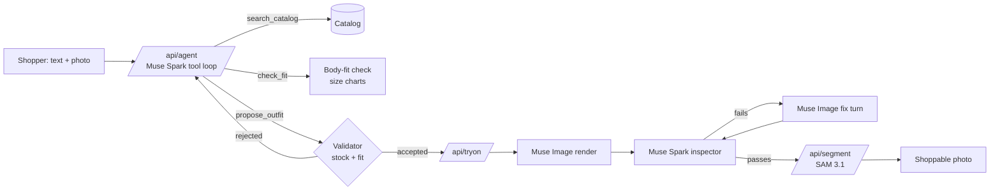

# Tryzeon Fashion Agent

**Live demo: https://tryzeon-fashion-agent.vercel.app** — open the store, press **Style me**.

An AI stylist any fashion brand can add to its website with one line. Tell it where you're going (or show it a photo you like), and it builds a complete outfit from the brands' real stock, checks every piece against your body measurements, renders the whole outfit on your photo, inspects its own render against each product photo, fixes what doesn't match, and turns the result into a shoppable image.

Built for the Meta Global AI Developer Hackathon (Oct 26 – Nov 4, 2026), Startup track, by [Tryzeon](https://tryzeon.com).

## What happens when you ask for an outfit

| Step | What you see | Meta model |
|---|---|---|
| 1. Understand | Your request, plus an inspiration photo if you attach one | Muse Spark (vision) |
| 2. Agent reasoning | A live trace: catalog searches with results, fit checks | Muse Spark tool calling |
| 3. Recommend | An outfit card where every piece is in stock and fits you | Server-side validator the agent must pass |
| 4. Try on | The whole outfit rendered on your photo in one call | Muse Image (multi-image composition) |
| 5. Self-check | Each piece scored against its product photo, plus identity | Muse Spark (vision, structured output) |
| 6. Fix | A targeted re-render of only what failed | Muse Image multi-turn (`previous_response_id`) |
| 7. Swap by chat | "Swap the jacket for a black puffer" changes only the jacket | Muse Spark agent + Muse Image multi-turn edit |
| 8. Shop the photo | Tap any garment in your render to open the product | SAM 3.1 segmentation |

The demo store itself was generated with Meta models: Muse Spark wrote the three brands' 60-product line, Muse Image shot every product photo, and Muse Spark vision then re-read each photo to record its true colors and look, so search matches what shoppers actually see.



## Results

From `scripts/eval.ts` on 10 requests across two shoppers ([eval/results.json](eval/results.json)):

| Metric | Result |
|---|---|
| Agent produced a valid outfit | 10 / 10 |
| Every piece fits the shopper's measurements | 10 / 10 |
| Request constraints met (warmth, brand, budget, required pieces) | 10 / 10 |
| Median agent time / tool calls | 16 s / 7 calls |
| Try-on passes inspection on the first render | 6 / 10 |
| Try-on passes inspection after self-check and fix | 10 / 10 |
| Median time to verified try-on | 44 s (first image ~29 s) |

Caveats: n = 10. Try-on pass rates are judged by the same Muse Spark inspector the product uses, not by people; we spot-checked renders by eye but did not run a human rating study.

## Embed it

```html
<script src="https://tryzeon-fashion-agent.vercel.app/embed.js" defer></script>
```

The script adds a launcher and opens the stylist in an iframe. Tapping a product in the try-on dispatches a `tryzeon:product` event on the host page with the product id.

## Code map

| Path | What it does |
|---|---|
| `api/agent.ts` | Muse Spark agent loop with `search_catalog`, `check_fit`, `propose_outfit`; streams NDJSON events |
| `api/tryon.ts` | Full render or swap with Muse Image, Muse Spark inspection, fix turns, best-attempt selection |
| `api/segment.ts` | SAM 3.1 masks per garment, decoded with `@meta-sam/parser` |
| `shared/fit.ts` | Body-fit check: measurements vs. size charts per fit style and stocked sizes |
| `scripts/generate-catalog.ts` | Generates the catalog: `specs` (Muse Spark), `images` (Muse Image), `enrich` (Muse Spark vision), `demo` |
| `scripts/eval.ts` | The evaluation above |
| `src/agent/` | The stylist widget |
| `src/store/` | The demo store |
| `public/embed.js` | One-line embed |

## Run it

```bash
cp .env.example .env.local   # META_API_KEY from https://dev.meta.ai
npm install
vercel dev                   # Vite frontend + api/ functions
npx tsx --env-file=.env.local scripts/eval.ts
```

## Built during the hackathon

Everything in this repository was written between Oct 26 and Nov 4, 2026. Tryzeon's production app (live on LINE in Taiwan, with our own try-on pipeline and body-fit algorithm) is a separate private codebase; none of its code, data or infrastructure is used here. This project rebuilds the recommend-to-try-on loop from scratch on Meta's models, and the brands and products in the demo store are fictional and generated.
